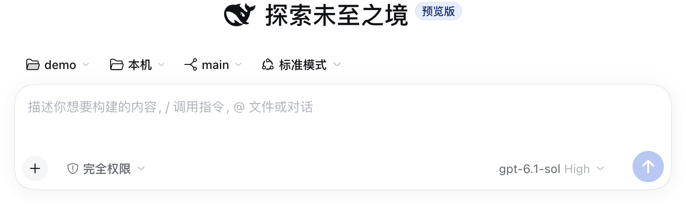
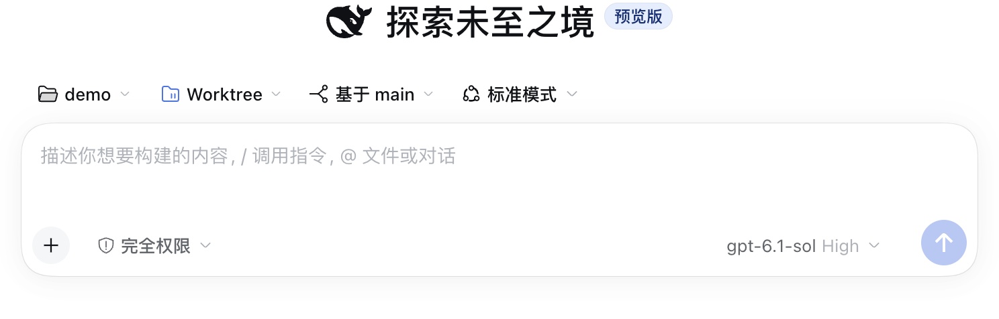
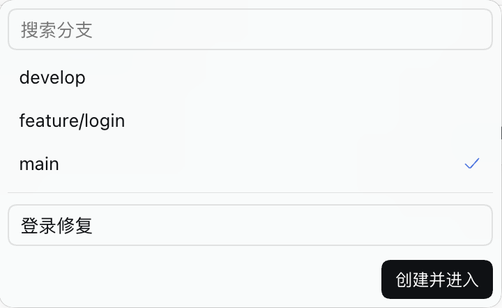
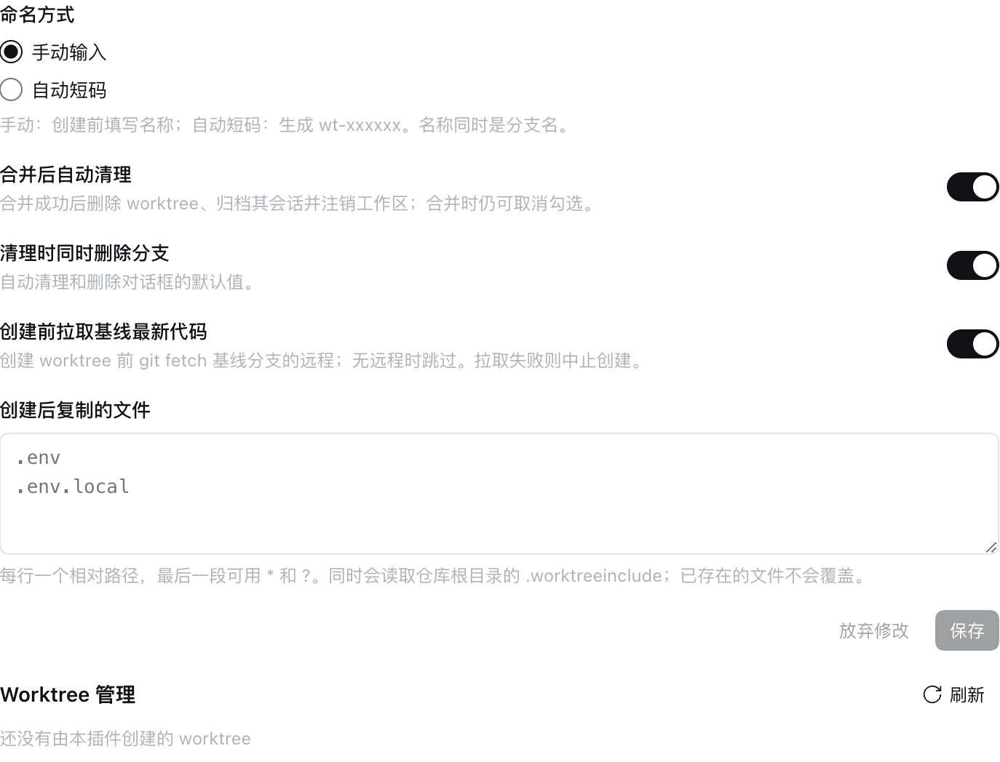

# dsh-useful-tools（有用的插件集合）

[](https://github.com/G-Grant/dsh-useful-tools/actions/workflows/release.yml)

DeepSeek Harness 插件（原名「有用的插件集合」，现为 Worktree 管理）：在空白会话里选择本机或 Worktree。Worktree 会在仓库里建一个隔离目录，并在会话头部合并、删除和自动清理。

> 本包由 `dsh-worktree-manager` 与 `dsh-sidebar-collapse` 合并而来。侧边栏收起功能已随客户端内置的侧边栏折叠退役（0.2.0 起移除），升级时请先卸载旧包，见[从旧插件迁移](#从旧插件迁移)。

## Worktree 管理

只在**仓库主目录的空白会话**里出现。工作区右侧有两个 chip：环境、分支。



- **本机**：分支 chip 是当前检出。改选会执行 `git switch`。有未提交改动，或该分支已被其他 worktree 占用时，拒绝切换。
- **Worktree**：不改本机检出。环境 chip 只显示 Worktree，分支 chip 表示基线，或复用的分支。



分支面板顶部可选「新分支」或「已有分支」。默认选中「新分支」。

- **新分支**：选择基线，填写新分支名，然后点「创建 Worktree」。
- **已有分支**：选择空闲的本地分支或仅在远程存在的分支，然后点「创建 Worktree」。选远程分支时会创建同名本地跟踪分支。



新建分支：

- 名称可用中文。同一段文字同时作为分支名、目录名和工作区标题。
- 不能包含空格或特殊符号。名称里的 `/` 仍是分支层级，目录名会收成 `-`，例如 `功能/超时` 的目录是 `功能-超时`。
- 命名方式为自动短码时，面板里没有输入框，创建时生成 `wt-xxxxxx`。

复用已有分支：

- 工作区标题取本地分支名。目录名会处理斜线，例如 `feat/login` 对应目录 `feat-login`。
- 本机或其他 worktree 已检出的分支显示「使用中」。已有同名本地分支时，列表提供该本地分支。
- 会话头部显示分支名，删除 worktree 时保留分支。提交直接进入检出的本地分支。

两种方式都：目录固定为 `<仓库根>/.agents/worktrees/<目录名>`，重名时自动加 `-2` 等后缀；创建后打开这个工作区的空白会话，并带上当前草稿。

进入「新建分支」的 worktree 会话后，头部显示 `分支 → 基础分支`，以及「合并」「删除」。

## 配置

在「插件」页打开 Worktree 管理。下面是配置和 worktree 列表；列表里可以合并、改标题、删除。



| 配置项 | 默认值 | 说明 |
| --- | --- | --- |
| `namingMode` | `manual` | `manual` 手动输入名称；`auto` 自动短码 `wt-xxxxxx` |
| `autoCleanup` | `true` | 合并成功后自动清理。合并对话框里仍可取消 |
| `deleteBranchOnCleanup` | `true` | 清理时同时删除分支，也是删除对话框的默认值 |
| `fetchBaseBeforeCreate` | `true` | 创建前 `git fetch` 基线分支的远程最新提交。无远程时跳过，失败则中止创建 |
| `copyFiles` | `[]` | 创建后额外复制的文件。另外会读取仓库根目录的 `.worktreeinclude` |

复制规则：每行一个仓库内相对路径，可以是文件或目录，最后一段可用 `*` / `?`。不覆盖已存在文件，不跟随符号链接，禁止 `..` 与 `.git`。建议只列被 `.gitignore` 忽略的文件，否则复制过去的未跟踪文件会被算作未提交改动。

## 合并

预检不通过时直接拒绝，不做自动处理：

- worktree 有未提交改动；
- 主仓库不在目标分支，或主仓库有未提交改动；
- 没有可合并的提交。

合并方式有两种，会记住上次的选择：

- **合并提交**：`git merge --no-ff`，保留分支上的提交。
- **压缩为一个提交**：squash。提交信息优先用 LLM 生成，不可用时预填各提交标题。

冲突时自动回滚，列出冲突文件，可一键「交给 Agent 解决」。squash 之后 git 不认为分支已合并，所以自动清理对分支使用 `-D`。手动删除未合并分支时需要二次确认。

## 安装

```sh
pnpm install
pnpm run build:all

# 链接到某个 profile（桌面版 profile 名为 desktop）
dsh plugin --profile desktop add "link:$(pwd)"
```

重启 profile 后，在「插件」页启用「有用的插件集合」。本插件与 `dsh-git-branch-manage` 可并存：包名、配置项 id、locale 命名空间、路由前缀、slot id 均独立。

## 从旧插件迁移

本包已包含旧 worktree 插件的全部功能，不要同时安装。侧边栏收起已移除，请改用客户端自带的侧边栏折叠。迁移步骤：

```sh
dsh plugin --profile desktop remove dsh-worktree-manager
dsh plugin --profile desktop remove dsh-sidebar-collapse   # 若仍装着
dsh plugin --profile desktop add "link:/path/to/dsh-useful-tools"   # 或已发布的 tarball
```

重启后确认「插件」页只剩一行「有用的插件集合」。配置项会保留：沿用原有字段名与存储位置。

## 开发

```sh
pnpm run typecheck   # 宿主侧与客户端
pnpm test            # vitest，git 逻辑用真实临时仓库验证
pnpm run build:all   # tsc（host）+ tsdown（client bundle）
```

- `src/index.ts`、`src/routes.ts`、`src/git.ts`：宿主侧配置、HTTP 路由与 git 逻辑
- `src/client/`：浏览器侧（chips、对话框、配置页、管理列表）
- `src/wire.ts`：两侧共享的路由与类型
- `docs/decisions/`：设计决策（0001 挂载与创建时机，0002 chip 语义，0003 官方池路径与标题，0004 创建前 fetch 与配置页，0005 中文名称与创建面板，0006 复用已有分支，0007 侧边栏收起退役）
- `docs/images/`：README 用的界面截图

## 发布

`main` 分支上 `package.json` 的 `version` 变化后，GitHub Actions 会跑类型检查、测试与构建，创建对应的 GitHub Release（tag `v<version>`）并上传预构建 tarball。预发布版本（例如 `0.1.0-beta.1`）自动标记为 prerelease。

## 限制

- 只在 macOS 上开发与验证。
- 新分支模式通过 Git 配置 `branch.<name>.dsh-worktree-base` 识别基线。已有分支模式的标记保存在对应 worktree 的 Git 注册目录中。
- 复用已有分支的 worktree 不参与合并：它的改动本来就在那个分支上，没有需要合回的基线。
- worktree 目录固定为 `<仓库根>/.agents/worktrees`，不支持自定义。
- 不提供 commit、push、diff 等通用 git 操作。
